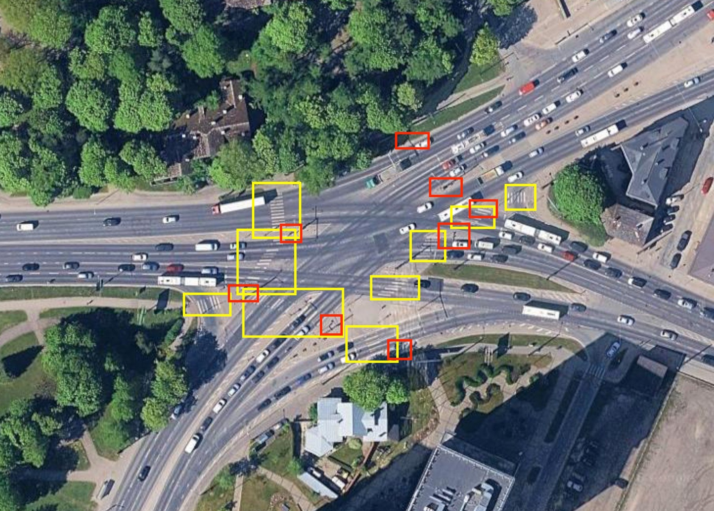

# Valgusfoor – Paldiski mnt / Endla tn / Mustamäe tee ristmik

Kursuse kokkuvõttev liiklusprojekt (2 osalejat).

Ristmiku 8 foori on simuleeritud ekraanil, 2 neist on lisaks füüsilised (ESP8266).

## Praegune sisu

- `index.html` – veebileht: ekraani foorid ja juhtpaneel (Web Serial kaudu ESP8266-ga)
- `sketch_valgusfoor/` – ESP8266 püsivara füüsilisele foorile

## Esitamiseks vajalik

- [ ] Toimiv lahendus (esitlus 30. novembril algaval nädalal)
- [ ] Hommikune, õhtune ja öörežiim
- [ ] Vähemalt 1 kaubandusliku välimusega, põrutuskindel (30 cm kukkumine) komponent
- [ ] Elektriskeem
- [ ] Andmete liikumise skeem + pakettide näited
- [ ] Installijuhend
- [ ] Video (üldvaade + detailid)
