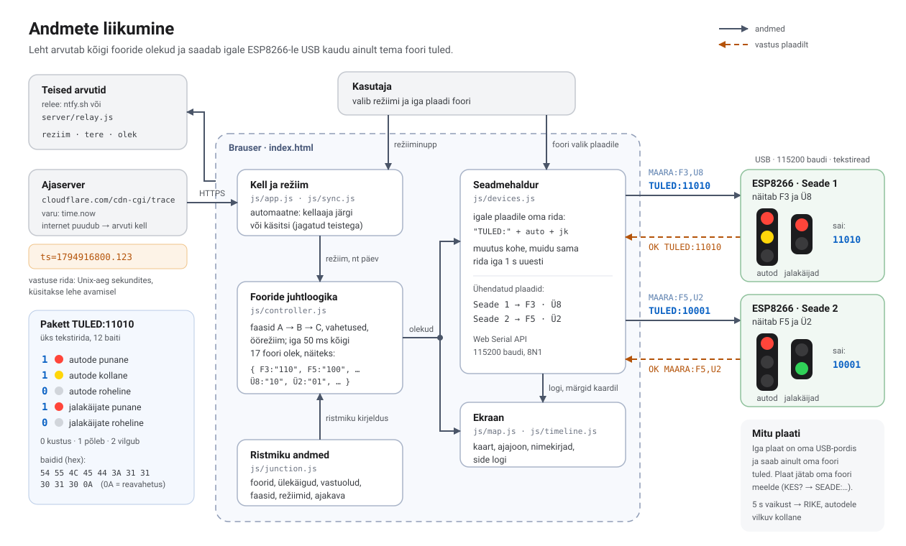
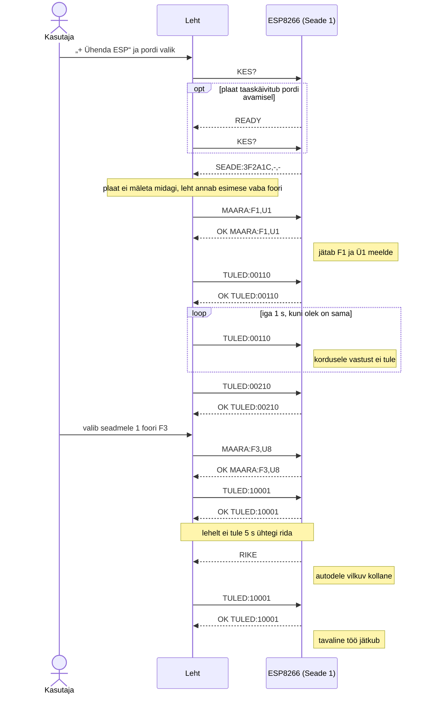
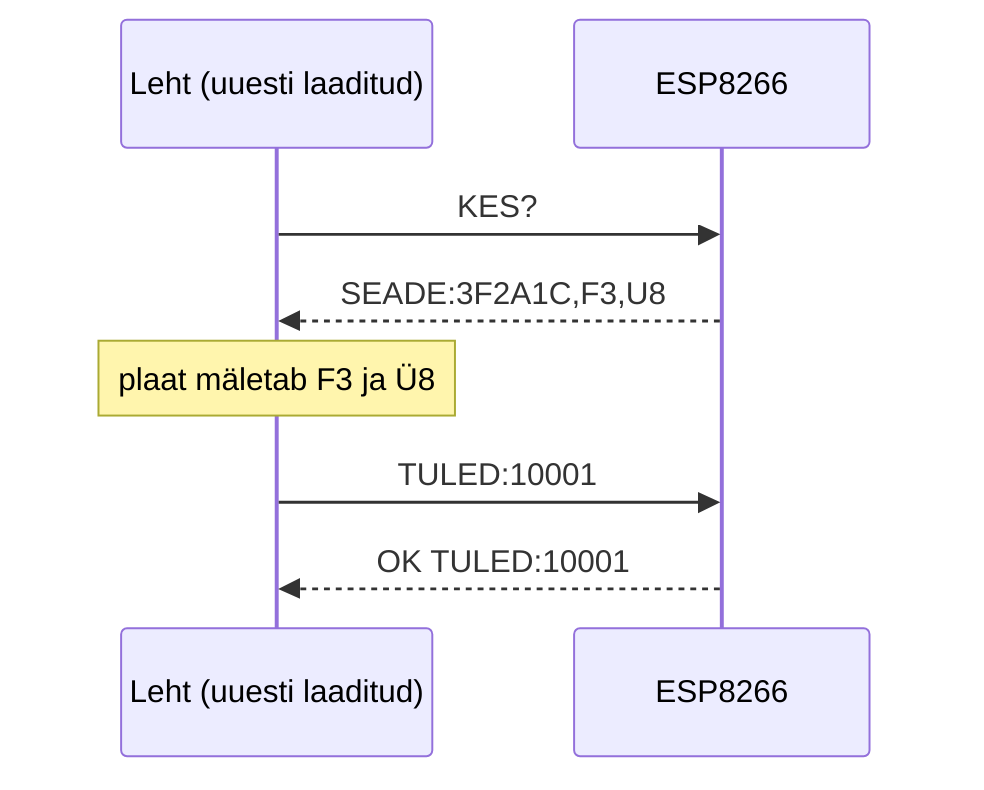
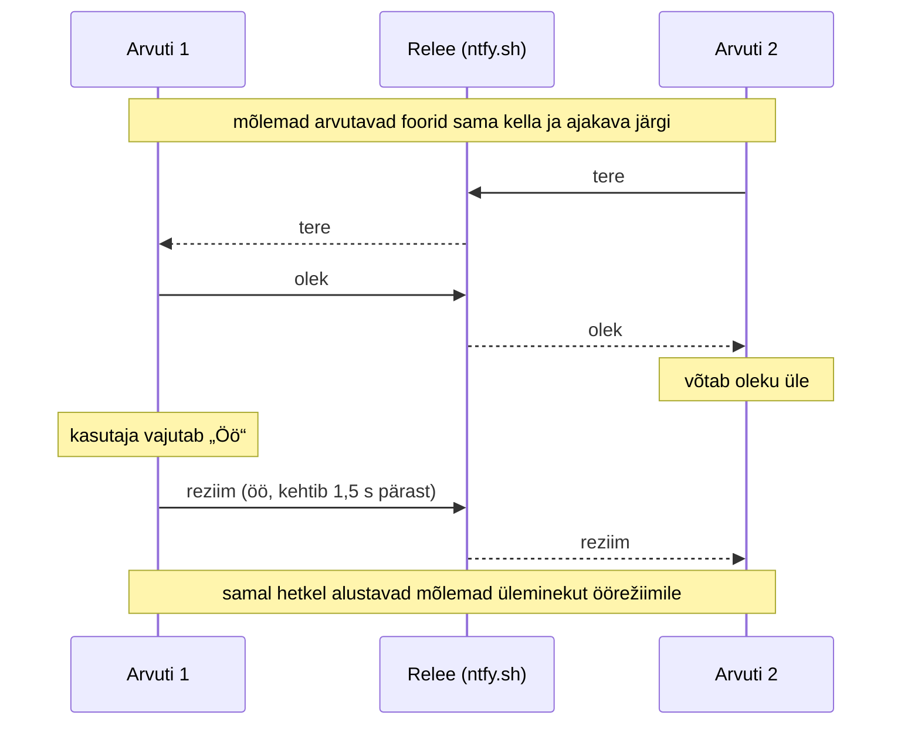

# Andmete liikumine

Kogu foorikava arvutatakse veebilehel. ESP8266 plaadid ristmikust midagi ei tea: leht ütleb igale
plaadile USB kaudu, millised tema viiest tulest põlevad.



## Kust kuhu

| Samm | Kust → kuhu | Mis liigub | Millal |
|---|---|---|---|
| 1 | ajaserver → leht | HTTPS-vastuses rida `ts=1794916800.123` (Unix-aeg sekundites, siin 17.11.2026 kell 14:00 Eesti aja järgi) | lehe avamisel ja iga 5 minuti tagant, iga kord 5 mõõtmist; kui internet ei vasta, kasutatakse arvuti kella |
| 2 | kasutaja → leht | režiim: automaatne, hommik, päev, õhtu või öö | nupuvajutusel |
| 3 | `junction.js` → juhtloogika | foorid, ülekäigud, vastuolulised suunad, faasid, režiimid, ajakava | lehe laadimisel |
| 4 | kell → juhtloogika | soovitud režiim, nt `paev` | pidevalt; uus režiim hakkab kehtima ohutult pärast praegust faasi |
| 5 | juhtloogika → ekraan ja seadmehaldur | iga foori olek, nt `{ F3: "110", F5: "100", Ü8: "10", Ü2: "01", … }` | ekraanile iga kaadri järel, seadmetele iga 50 ms |
| 6 | kasutaja → seadmehaldur | millist foori ja ülekäiku iga plaat näitab | valikul |
| 7 | leht → plaat (USB) | `KES?`, `MAARA:F3,U8`, `TULED:11010` | `KES?` ühendamisel; `MAARA` valiku muutmisel; `TULED` kohe muutusel, muidu iga 1 s |
| 8 | plaat → leht (USB) | `READY`, `SEADE:…`, `OK …`, `VIGA …`, `RIKE` | käivitusel, vastusena käsule või rikke korral |
| 9 | plaat → LED-id | viigud HIGH või LOW | kohe pärast käsku |
| 10 | leht → relee → teised lehed | `reziim`, `tere`, `olek` (JSON, vt [Mitu arvutit](#mitu-arvutit)) | režiimi muutusel ja ruumiga liitumisel |

## Paketid

Side käib tekstiridadena üle USB jadapordi: 115200 baudi, 8 andmebitti, paarsuseta, 1 stoppbitt
(8N1). Iga rida lõpeb reavahetusega (`\n`). Leht saadab ainult ASCII-märke, seega `Ü8` asemel `U8`.

| Suund | Pakett | Tähendus |
|---|---|---|
| leht → plaat | `KES?` | küsib plaadi kiibi numbrit ja meelde jäetud foori |
| leht → plaat | `MAARA:F3,U8` | plaat näitab autode foori F3 ja ülekäiku Ü8 ning jätab selle meelde; `-` tähendab „puudub“, nt `MAARA:F3,-` |
| leht → plaat | `TULED:11010` | viie tule olek, vt allpool |
| plaat → leht | `READY` | plaat käivitus; leht saadab kohe `MAARA` ja `TULED` uuesti (uuelt plaadilt küsib enne `KES?`) |
| plaat → leht | `SEADE:3F2A1C,F3,U8` | vastus `KES?`-le: kiibi number, autode foor ja ülekäik; tühja mäluga plaat vastab `SEADE:3F2A1C,-,-` |
| plaat → leht | `OK MAARA:F3,U8` | käsk täideti |
| plaat → leht | `OK TULED:11010` | uus olek on LED-idel; sama oleku kordusele vastust ei tule |
| plaat → leht | `VIGA TULED:9` | tundmatu käsk või vale väärtus |
| plaat → leht | `RIKE` | lehelt pole 5 s midagi tulnud; plaat vilgutab autodele kollast, kuni ridu jälle tuleb |

### `TULED` paketi sisu

`TULED:` järel on viis numbrit, igaüks ühe tule kohta:

| Koht | 1 | 2 | 3 | 4 | 5 |
|---|---|---|---|---|---|
| Tuli | autode punane | autode kollane | autode roheline | jalakäijate punane | jalakäijate roheline |
| Viik | D3 | D4 | D5 | D1 | D2 |

`0` = kustus, `1` = põleb, `2` = vilgub (0,5 s põleb, 0,5 s kustus). Kõik olekud, mis ette tulevad:

| Pakett | Autode foor | Jalakäijate foor |
|---|---|---|
| `TULED:00110` | roheline | punane |
| `TULED:00210` | vilkuv roheline, kohe tuleb kollane | punane |
| `TULED:01010` | kollane | punane |
| `TULED:10010` | punane | punane |
| `TULED:11010` | punane + kollane, kohe tuleb roheline | punane |
| `TULED:10001` | punane | roheline |
| `TULED:10002` | punane | vilkuv roheline, kohe tuleb punane |
| `TULED:02000` | vilkuv kollane (öörežiim) | kustus |
| `TULED:00000` | plaadile pole foori määratud | – |

### Üks pakett baitidena

`TULED:11010` koos reavahetusega on 12 baiti:

| Märk | `T` | `U` | `L` | `E` | `D` | `:` | `1` | `1` | `0` | `1` | `0` | `\n` |
|---|---|---|---|---|---|---|---|---|---|---|---|---|
| Bait (hex) | 54 | 55 | 4C | 45 | 44 | 3A | 31 | 31 | 30 | 31 | 30 | 0A |

8N1 puhul on iga bait juhtmes 10 bitti, seega 12 baiti = 120 bitti ≈ 1 ms. Üks plaat saab umbes
1–2 rida sekundis (alla 30 baiti sekundis), kanal mahutab 11 520 baiti sekundis.

## Ühendamine ja töö



## Plaat mäletab oma foori

Kui lehel valitakse plaadile foor, saadab leht `MAARA` ja plaat salvestab selle välkmällu (ainult siis,
kui valik muutus). Kui plaat hiljem uuesti ühendatakse – leht laaditi uuesti, USB-kaabel tõmmati välja
ja pandi tagasi või plaat on hoopis teises arvutis –, küsib leht `KES?` ja võtab plaadi meelde jäetud
foori üle. `MAARA`-t pole siis vaja saata:



- `3F2A1C` on plaadi kiibi number. Leht näitab seda seadme nime kõrval, nii et on näha, milline
  füüsiline plaat on milline. Kui sama plaat ühendatakse uuesti, saab ta lehel tagasi oma vana numbri
  ja katkenud ühenduse rida kaob.
- Tühja mäluga plaat vastab `SEADE:3F2A1C,-,-` ja leht annab talle esimese vaba foori.
- Kuni plaat pole vastanud, talle tulesid ei saadeta ja ta vilgutab kollast.
- Kui plaat ei vasta (leht küsib 3 s jooksul kolm korda) või vastab `VIGA KES?` (vana püsivara), saab
  ta esimese vaba foori nagu varem.

## Mitu plaati korraga

Iga plaat on eraldi USB-port ja lehel eraldi seade. Leht arvutab ristmiku olekud üks kord ja teeb
igale plaadile oma `TULED` rea selle järgi, millist foori ja ülekäiku plaat näitab.

Näide päevarežiimist: Seade 1 näitab foori F3 ja ülekäiku Ü8, Seade 2 foori F5 ja ülekäiku Ü2. Aeg
on lehe avamisest. Tühi lahter tähendab, et olek ei muutunud ja leht kordab eelmist rida iga sekund.

| Aeg | Ristmik | Seade 1 (F3 · Ü8) | Seade 2 (F5 · Ü2) |
|---|---|---|---|
| 0 s | foorid lähevad tööle | `TULED:01010` | `TULED:01010` |
| 3 s | | `TULED:10010` | `TULED:10010` |
| 5 s | | | `TULED:11010` |
| 6 s | faas A | `TULED:10001` | `TULED:00110` |
| 26 s | vahetus A → B | | `TULED:00210` |
| 29 s | | | `TULED:01010` |
| 32 s | | | `TULED:10010` |
| 34 s | faas B | | `TULED:10001` |
| 48 s | vahetus B → C | `TULED:10002` | |
| 51 s | | `TULED:10010` | |
| 55 s | | `TULED:11010` | |
| 56 s | faas C | `TULED:00110` | |
| 70 s | vahetus C → A | `TULED:00210` | `TULED:10002` |
| 73 s | | `TULED:01010` | `TULED:10010` |
| 76 s | | `TULED:10010` | |
| 77 s | | | `TULED:11010` |
| 78 s | faas A | `TULED:10001` | `TULED:00110` |

Iga muudatuse järel vastab plaat `OK TULED:…`. Tabel on saadud `js/controller.js`-i käivitamisel ja
`test/devices.test.js` kontrollib sama asja kaheksa plaadiga korraga.

### Öörežiim

Kui kell 23:00 saab režiimiks öö (või kasutaja vajutab „Öö“), lõpetatakse praegune faas tavaliselt:
vilkuv roheline, kollane ja 2 s kõik punased. Siis vilgub kõigile autodele kollane ja jalakäijate
foorid kustuvad. Näide, kus „Öö“ valiti 100. sekundil vahetuse A → B ajal:

| Aeg | Ristmik | Seade 1 (F3 · Ü8) | Seade 2 (F5 · Ü2) |
|---|---|---|---|
| 106 s | faas B, öö ootel, roheline ainult 5 s | | `TULED:10001` |
| 111 s | üleminek öörežiimile | `TULED:10002` | `TULED:10002` |
| 114 s | | `TULED:10010` | `TULED:10010` |
| 119 s | öörežiim | `TULED:02000` | `TULED:02000` |

Öörežiimi lõpus (kell 06:00) on sama jada mis lehe avamisel: 3 s kollane, 2 s kõik punased, faasi A
fooridele 1 s punane + kollane ja siis roheline.

## Mitu arvutit

Lehe võib avada mitmes arvutis, igaühe küljes oma plaadid. Iga leht arvutab foorid ise, aga nii, et
tulemus on kõigis arvutites igal hetkel sama:

1. **Ühine kell.** Leht küsib aega internetist (cloudflare.com, varu time.now; oma relee korral
   releelt) viis korda ja võtab kõige kiirema vastuse, nii et viga on alla poole päringu ajast,
   tavaliselt ±10–30 ms. Aega küsitakse uuesti iga 5 minuti tagant. Väike parandus tehakse sujuvalt
   (kuni 50 ms sekundis), et foorid ei hüppaks.
2. **Ühine alguspunkt.** Foorid arvutatakse kohalikust südaööst alates ajakava järgi (südaööl on alati
   öörežiim). Eri ajal avatud lehed on seega samas olekus ka ilma omavahelise ühenduseta.
3. **Ühised käsud.** Režiimi muutus saadetakse relee kaudu kõigile sama ruumi lehtedele. Sõnumis on
   hetk, millal muutus kehtima hakkab (1,5 s pärast klõpsu, et sõnum jõuaks kõigini), ja kontrolleri
   olek sel hetkel. Nii jõuab ka hiljem liituv leht täpselt samasse olekusse.

Relee on vaikimisi tasuta avalik [ntfy.sh](https://ntfy.sh) (HTTPS, teema nimi `ristmik-<ruumi kood>`,
sõnumid on seal 12 tundi vahemälus). Teine võimalus on `node server/relay.js` ühes arvutis: sama API,
lisaks annab see kellaaja (`/aeg`), nii et arvutid on samas taktis ka ilma internetita.

| Sõnum | Millal | Sisu |
|---|---|---|
| `reziim` | kasutaja valis režiimi | kehtimise hetk, automaatne või käsitsi, režiim ja kontrolleri olek sel hetkel |
| `tere` | leht liitus ruumiga | ainult saatja tunnus |
| `olek` | vastus `tere`-le; vastab üks juba töötav leht | praegune hetk, režiim ja kontrolleri olek |

Päris `reziim` sõnum (käsitsi öörežiim, kehtib 23.11.2026 kell 12:50:25,790; sel hetkel käib
vahetus A → B, mis algas 12:50:22):

```json
{"v":1,"t":"reziim","id":"t9gtz1xjzdrm","from":"0q6o1cus683v","at":1795431025790.1,"auto":false,"mode":"oo",
 "snap":{"wanted":"paev","mode":"paev","cycleStart":1795431002000,
         "seg":{"type":"change","stage":0,"next":1,"start":1795431022000,"duration":8000}}}
```



- Plaatidele ei saadeta midagi enne, kui kell on sünkroniseeritud ja ruumi olek teada (kuni ~3 s
  pärast lehe avamist). Seni vilgutavad plaadid kollast.
- Kui relee ei vasta, on automaatrežiimis arvutid ikka samas taktis. Ühenduseta arvutis valitud
  käsitsi režiim jääb aga ainult sellesse arvutisse.
- Kui kaks arvutit valivad režiimi peaaegu korraga, jääb kehtima hilisem ja kõik arvutid jõuavad
  samasse olekusse.

## Ajastus

- Leht saadab muutused plaatidele iga 50 ms, nii et füüsiline foor jääb ekraanist maha kuni 50 ms
  (pluss ~1 ms juhtmes).
- Plaat hakkab vilgutama käsu saabumise hetkest, nii et vilkumine käib ekraaniga samas taktis.
- Sama rida korratakse iga 1 s. Plaat läheb rikkerežiimi alles 5 s vaikuse järel, nii et paar kaotsi
  läinud rida ei sega.
- Hoia leht esitluse ajal nähtaval. Kui vahekaart on peidus, aeglustab brauser lehe taimereid:
  muutused jõuavad plaatideni hiljem ja pikema aja jooksul võivad plaadid minna rikkerežiimi.
- Mitme arvuti puhul lisandub kellade erinevus, tavaliselt alla 30 ms.

## Logi

Lehe plokis „Side seadmetega“ on kõik saadetud ja saadud read peale sama rea korduste. Nupp
„Salvesta logi“ salvestab need tekstifailina. Näide:

```
14:05:48  Seade 1 → TULED:10002
14:05:48  Seade 1 ← OK TULED:10002
14:05:51  Seade 1 → TULED:10010
14:05:51  Seade 1 ← OK TULED:10010
14:05:55  Seade 1 → TULED:11010
14:05:55  Seade 1 ← OK TULED:11010
14:05:56  Seade 1 → TULED:00110
14:05:56  Seade 1 ← OK TULED:00110
```
