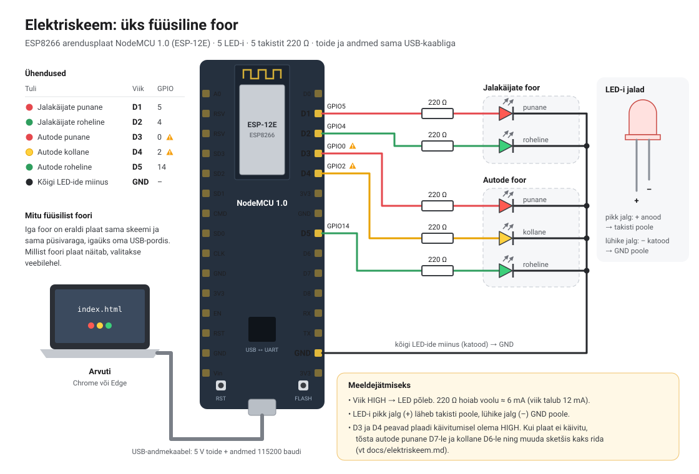

# Elektriskeem

Iga füüsiline foor on üks ESP8266 arendusplaat (NodeMCU 1.0, ESP-12E), viis LED-i ja viis takistit.
Toide ja andmed tulevad arvutist sama USB-kaabli kaudu, eraldi toiteallikat pole vaja.



## Ühendused

| Tuli | Plaadi viik | GPIO | Takisti | Muutuja sketšis |
|---|---|---|---|---|
| Autode punane | D3 | GPIO0 | 220 Ω | `carRed` |
| Autode kollane | D4 | GPIO2 | 220 Ω | `carYellow` |
| Autode roheline | D5 | GPIO14 | 220 Ω | `carGreen` |
| Jalakäijate punane | D1 | GPIO5 | 220 Ω | `pedRed` |
| Jalakäijate roheline | D2 | GPIO4 | 220 Ω | `pedGreen` |
| Kõigi LED-ide miinus | GND | – | – | – |

Iga LED on ühendatud nii: **viik → takisti → LED-i pikk jalg (+, anood) → LED-i lühike jalg (–, katood) → GND**.
Kui viik on HIGH (3,3 V), LED põleb. Takisti võib olla ka LED-i ja GND vahel, vool on sama.
Plaadil on kolm GND viiku, sobib ükskõik milline.

## Komponendid ühe foori kohta

| Kogus | Komponent | Märkus |
|---|---|---|
| 1 | ESP8266 arendusplaat NodeMCU 1.0 (ESP-12E) | sobib ka Wemos D1 mini: viikude nimed on samad, asukohad teised |
| 2 | punane LED, 5 mm | autodele ja jalakäijatele |
| 1 | kollane LED, 5 mm | |
| 2 | roheline LED, 5 mm | autodele ja jalakäijatele |
| 5 | takisti 220 Ω | sobib 150–330 Ω |
| 1 | makettplaat ja juhtmed | |
| 1 | micro-USB **andmekaabel** | ainult laadimiseks mõeldud kaabliga arvuti plaati ei näe |

## Takisti valik

ESP8266 viik annab 3,3 V ja talub kuni 12 mA. Punase ja kollase LED-i pinge on umbes 2 V, seega
vool on (3,3 V − 2,0 V) / 220 Ω ≈ 6 mA. Korraga põleb kuni kolm LED-i (autodele punane + kollane ja
jalakäijatele punane), kokku umbes 18 mA.

Ereroheline (sinakas) LED vajab umbes 3 V ja jääb 220 Ω-ga tuhmiks, siis sobib 100 Ω.

## Mitu foori

Iga füüsiline foor on eraldi plaat sama skeemi ja sama püsivaraga. Millist ristmiku foori plaat
näitab, valitakse veebilehel ja plaat jätab selle meelde, nii et plaate pole vaja eraldi seadistada.
Kleebi plaadile tema foori tähis (nt F3), siis on füüsilisi foore lihtne eristada. Iga plaat läheb oma
USB-porti; plaatide GND-sid pole vaja omavahel ühendada.

Plaat tarbib koos LED-idega alla 200 mA. Toiteta USB-jaoturisse ühenda kuni kaks plaati, rohkemate
jaoks kasuta toitega jaoturit või arvuti eri porte.

## Kontroll enne veebilehe kasutamist

1. Laadi `sketch_valgusfoor/sketch_valgusfoor.ino` plaadile.
2. Ava Arduino IDE Serial Monitor: 115200 baudi, reavahetus „Newline“. Plaat kirjutab `READY` ja
   autode kollane vilgub.
3. Saada `KES?` – plaat vastab oma kiibi numbriga, nt `SEADE:3F2A1C,-,-` (foori pole veel määratud).
4. Saada `TULED:11111` – kõik viis LED-i põlevad. `TULED:22222` – kõik vilguvad, `TULED:00000` – kõik
   on kustus.
5. Kui 5 s jooksul uut käsku ei tule, kirjutab plaat `RIKE` ja vilgutab jälle kollast. Nii peabki.
6. Sulge Serial Monitor enne veebilehe kasutamist, sest porti saab korraga kasutada ainult üks programm.

## Kui plaat ei käivitu

D3 (GPIO0) ja D4 (GPIO2) on käivitusviigud: plaadi sisselülitamisel peavad need olema HIGH. LED
koos takistiga tõmbab neid GND poole ja mõni plaat jääb siis püsivara laadimise režiimi. Siis ei tule
Serial Monitoris `READY`-t ja LED-id ei vilgu; 74880 baudiga on näha `boot mode:(1,…)`.

Lahendus: tõsta kaks juhet ümber ja muuda sketšis kaks rida.

| Tuli | Praegu | Uus viik |
|---|---|---|
| Autode punane | D3 | D7 (GPIO13) |
| Autode kollane | D4 | D6 (GPIO12) |

```cpp
const int carRed = D7;
const int carYellow = D6;
```

D4 küljes on ka plaadi enda sinine LED. See põleb siis, kui autode kollane on kustus, ja see on normaalne.
